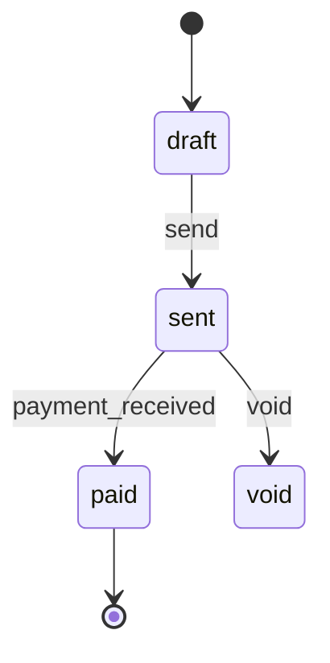

# Domain and business rules (DOM)

Goal: business rules live in one written, versioned, tested place that humans and agents read before touching domain code. Lightweight on purpose: three small files and one test convention, no DDD ceremony, no spec framework. It is NOT the architecture (→ `architecture.md`), the permissions matrix (→ `organization.md`, ORG-*), nor plan/price mechanics (→ `billing.md`).

## Layout

```
docs/domain/
  glossary.md     # ubiquitous language, one entry per term
  rules.md        # business-rules register, one entry per rule (R-001, R-002, ...)
  states/         # one file per entity with a lifecycle (Mermaid + transition table)
  limits.md       # quotas/limits table (or generated from the BIL-01 module)
```

Code lives in a domain layer (a module/package with no HTTP, UI or ORM-session imports) that exposes the operations and enforces the invariants; routes, jobs and UI only call it.

## Templates

Glossary entry (`glossary.md`):

```
### Workspace
Definition: one sentence, in the user's words.
Not to be confused with: Organization (billing owner; may hold many workspaces).
UI label: "Workspace" (translated per locale via its i18n key → I18N-01). Code name: `workspace`.
```

Rule entry (`rules.md`):

```
### R-012 Invoice cannot be edited after it is sent
Statement: an invoice in state `sent` or later rejects any change to lines, amounts or customer.
Why: legal/accounting record; customer already received it.
Enforced in: `domain/invoice.ts` → `assertEditable()`; DB check `invoice_locked`.
Test: `invoice.rules.test.ts` → "R-012 rejects edit when sent".
Status: active | superseded by R-0xx | proposed. Since: 2026-03 (changelog link).
```

State machine (`states/invoice.md`):

````

| From | To | Trigger | Who | Guard | Side effects |
| --- | --- | --- | --- | --- | --- |
| draft | sent | `send` | Admin+ | has >= 1 line, customer set | email to customer, audit entry, number assigned |
````

## Checklist

| ID | L | Requirement |
| --- | --- | --- |
| DOM-01 | 1 | `docs/domain/` exists with `glossary.md`, `rules.md` and `states/`; linked from the repo README and from the agent instructions file (CLAUDE.md/AGENTS.md); a new dev or agent finds it in one click |
| DOM-02 | 1 | Glossary has an entry for every domain noun shown in the UI or API (template above: definition, not-to-be-confused-with, UI label, code name); no two terms share a meaning and no concept has two names |
| DOM-03 | 1 | The glossary term is the same in UI copy, API field names, DB columns and code identifiers; a CI grep/lint list of banned synonyms (e.g. "client" vs "customer") passes, or the review shows a term-by-term table |
| DOM-04 | 1 | Business-rules register: every rule has an ID `R-nnn` (never reused), statement, why, where enforced (file + function), test name, status; template above |
| DOM-05 | 1 | Every active rule has at least one automated test whose name or tag contains its ID (`R-012`); a CI script fails if an active rule in `rules.md` has no matching test or a test references an unknown ID (→ CI-02) |
| DOM-06 | 1 | Rules are enforced in the domain layer (and by DB constraints where possible: CHECK, UNIQUE, FK, exclusion), never only in UI validation; proof: a test calls the domain function/API directly with a UI-impossible input and it is rejected with a typed error |
| DOM-07 | 1 | Domain layer has no imports from HTTP framework, UI, or request context; a dependency-boundary lint (e.g. dependency-cruiser, eslint boundaries) runs in CI (→ CI-02) |
| DOM-08 | 1 | Applies to entities with a lifecycle of 3+ states or with money or irreversible side effects (e.g. subscription, invoice, order, booking, invite, job, ticket); entities with only create/edit/delete are n/a (reason). Each such entity has a state file: Mermaid diagram plus transition table (from, to, trigger, who, guard, side effects); entities with a plain `status` string and no table are listed as gaps |
| DOM-09 | 1 | Applies where DOM-08 applies (n/a with reason when no entity has a state machine). State transitions go through one function per entity (`transition(entity, event)`); direct writes to the status column are forbidden outside it; a test iterates every non-allowed (from, event) pair and expects rejection |
| DOM-10 | 1 | Applies when a transition has a side effect outside the DB (email, push, webhook, billing); with none, n/a (reason). Transition side effects (email, webhook, audit entry, billing change) run in the same transaction or via an outbox, never "after the request if it works"; a test injects a failure (or kills the process) between steps and shows no half-applied state |
| DOM-11 | 1 | Every transition and sensitive rule violation returns a user-readable domain error code from a code catalog (`INVOICE_LOCKED`; a bare framework code such as FORBIDDEN does not count), mapped to a message the UI shows (→ UX-02); no raw 500 or generic "something went wrong" for a known rule |
| DOM-12 | 1 | Limits/quotas table (`limits.md` or generated from the entitlements module BIL-01): per plan, the limit, unit, scope (user; org/workspace for team accounts only), what happens at the limit (block, soft-warn, overage), and where it is checked; checked server-side in the domain layer (→ FIN-07, BIL-10) |
| DOM-13 | 1 | Limits are tested at N-1, N and N+1 (create the 3rd of 3 allowed, then the 4th is rejected) and under concurrency (two parallel creates at N-1 do not both succeed) |
| DOM-14 | 1 | Money rules written in the register (n/a if the app never handles money): rounding mode (e.g. half-even) and where it is applied, tax-inclusive vs exclusive, proration formula, currency per entity, refunds/credits sign convention; storage format → I18N-03; one `Money` type/module does all arithmetic |
| DOM-15 | 1 | Time rules written in the register: which date is a calendar day vs an instant, whose time zone defines "end of month"/"trial ends" (user or UTC; org for team accounts only), billing-period and trial boundaries inclusive/exclusive; stored as UTC instants (→ I18N-02); tests cover DST change, month end (Jan 31 + 1 month) and leap day |
| DOM-16 | 1 | Business operations are idempotent: create-invoice, send, charge, invite, import and any job-triggered action either carry a natural unique key (DB UNIQUE) or an idempotency key (→ API-04, PLT-03, BIL-03); a test runs each twice and shows one effect |
| DOM-17 | 1 | Delete policy per entity in a table (`rules.md` or `states/`): soft delete (with `deleted_at`, restore window, purge job), hard delete, or anonymize; default is soft delete for user-created business records and hard delete for ephemeral data (tokens, sessions, caches) |
| DOM-18 | 1 | (n/a, noted in one line, if DOM-17 chooses no soft delete anywhere) Soft-deleted rows are excluded by default at one layer (query scope / view / RLS), not by each caller; unique constraints account for deleted rows (partial unique index); a test shows deleted data absent from lists, search, counts, exports and limits |
| DOM-19 | 1 | Deleting an entity with dependents has a documented rule (block, cascade, detach, archive) per relation and the UI confirmation lists the consequences (→ AI-04 for agent-triggered deletes); no silent cascade |
| DOM-20 | 1 | Ownership on user departure table: for each user-owned entity type, what happens when the user deletes their account (or, team accounts only, leaves or is removed) (reassign, keep as "former member", anonymize, delete); consistent with ORG-23, ORG-25, LGL-04 and MOB-02; each row has a test |
| DOM-21 | 1 | Rule change process written in `docs/domain/README` or CONTRIBUTING: edit `rules.md` first, update the test with the same R-ID, add a changelog line (internal; user-facing if behavior changes → SUP-03) in the same PR; a PR touching a domain module without a `rules.md`/test change needs an explicit "no rule change" note in the PR template |
| DOM-22 | 1 | Retired rules are marked `superseded by R-nnn` or `removed` with date and reason, never deleted from the register; old IDs remain resolvable |
| DOM-23 | 1 | Agent instructions say: read `rules.md`, the glossary and the relevant `states/` file before changing a domain module; a new or changed behavior adds or edits a register entry and a test with its R-ID before the code; the agent never invents a rule, it asks or records it as `proposed` |
| DOM-24 | 2 | Existing behavior is back-filled: the 10 to 20 most important rules (money, access, limits, lifecycle) are extracted from code and support tickets into the register; each is verified by a test or marked `untested` and tracked |
| DOM-25 | 2 | Rules that depend on configuration (thresholds, grace periods, retention days) read it from one config/entitlements source named in the rule entry, not from literals scattered in code; a grep for the literal finds one place |
| DOM-26 | 2 | Cross-entity invariants (sum of lines = invoice total, seats used <= seats purchased, one active subscription per org) have a DB constraint or a nightly consistency check that alerts on violations (→ OBS-05, OPS-02) |
| DOM-27 | 2 | Every state transition and rule-driven denial is written to the audit trail with actor, from, to, reason (→ ADM-02); a support person can answer "why is this in state X" from the log, without reading code |
| DOM-28 | 2 | Glossary and rules are surfaced to users where they matter: tooltip/help link on non-obvious terms and limit messages ("Your plan allows 5 projects", link to plan) (→ ONB-07, SUP-02) |
| DOM-29 | 3 | Applies where DOM-08 applies or money arithmetic exists (n/a with reason otherwise). Property-based or model-based tests for the state machines and money arithmetic (e.g. fast-check, XState model tests): random event sequences never reach an illegal state or lose a cent |
| DOM-30 | 3 | Rules are executable policy for non-engineers: a rule table (pricing, eligibility, approvals) editable by ops with versioning, review and tests, instead of code deploys (decision tables, a rules engine) |

References: `organization.md` (ORG-23, ORG-25), `billing.md` (BIL-01), `i18n.md` (I18N-02, I18N-03)
